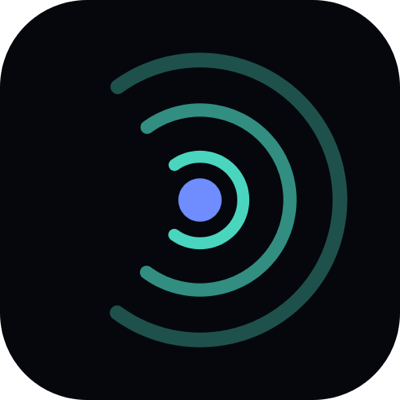

<p align="center"></p>

# AgenticWebScore MCP server

Scan a public website for AI agent readiness: 60 checks, a score, and the evidence for each.

AgenticWebScore measures how well a public website serves AI agents. One scan runs 60 checks from the outside, the way a crawler or an agent reaches the site:
- robots.txt and AI crawler rules;
- sitemaps, headings and structured data;
- HTTP caching and real 404s;
- markdown negotiation and llms.txt;
- OpenAPI and MCP servers.

Each check returns its status, the evidence it read, the source it follows, and a shell command that repeats the measurement. The score is 70% adopted web standards and 30% agent conventions, and every record carries a fingerprint you can verify.

This repository holds the listing files for the hosted server: this README, `server.json` for the [official MCP Registry](https://registry.modelcontextprotocol.io), the logo and client configs. The server itself runs at **https://agenticwebscore.com/mcp**.

## Connect

- **Transport:** Streamable HTTP. The server is stateless: one JSON-RPC message per POST, no session, and GET answers 405.
- **Authentication:** none. No API key and no sign-up.
- **Protocol versions:** 2025-11-25 and 2025-06-18.

Claude Code:

```sh
claude mcp add --transport http agenticwebscore https://agenticwebscore.com/mcp
```

Any client that reads an `mcpServers` file:

```json
{
  "mcpServers": {
    "agenticwebscore": {
      "type": "http",
      "url": "https://agenticwebscore.com/mcp"
    }
  }
}
```

Gemini CLI, as an extension (`gemini-extension.json`):

```sh
gemini extensions install https://github.com/marifeting/agenticwebscore-mcp
```

This repository is also a Cursor plugin (`.cursor-plugin/plugin.json` and `mcp.json`) and carries a LobeHub manifest (`lhm.plugin.json`). All of them point to the same remote endpoint.

## Tools

| Tool | What it does | Annotations |
|---|---|---|
| `scan_site` | Scans a public domain and returns the full record: the score and its two parts, the level, each check's status and evidence, and the fingerprint. A stored record younger than 6 hours is returned without a new scan, unless `fresh` is true. | not read-only, open world |
| `get_score` | Returns the stored record for a host. Starts no scan. | read-only |
| `list_checks` | Lists the 60 checks of rubric v0.9 with their kind, module, dimension and rationale. | read-only |
| `get_report` | Returns the markdown report of a stored record, or one check of it. Starts no scan. | read-only |

## Example prompts

- "Scan example.com for agent readiness and list the checks that failed."
- "What does example.com's robots.txt say to GPTBot and ClaudeBot?"
- "Read the stored AgenticWebScore report for cloudflare.com and explain its MCP result."
- "Which of the 60 checks are about llms.txt, and how is each scored?"

## Limits

- A new scan counts against 10 per client per minute and 3 running at once.
- A scan runs for up to 60 seconds. If a call times out first, the scan still finishes and is stored.
- A scan sends only GET requests to the site, apart from an MCP handshake (initialize and tools/list) when the site runs an MCP server. It never calls that server's tools.

## Links

- Website and web scanner: https://agenticwebscore.com
- The MCP server tester page: https://agenticwebscore.com/tools/mcp-server-tester
- Methodology and rubric: https://agenticwebscore.com/methodology
- Privacy: https://agenticwebscore.com/privacy · Terms: https://agenticwebscore.com/terms
- Contact: hello@agenticwebscore.com

Operated by Marifeting. Scanning is free.

## License

The files in this repository are MIT-licensed (see `LICENSE`). The hosted service is covered by its [terms](https://agenticwebscore.com/terms).
